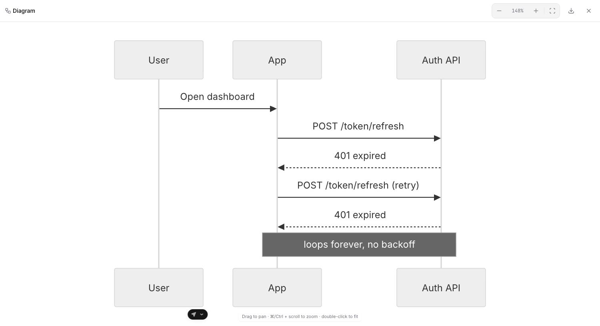
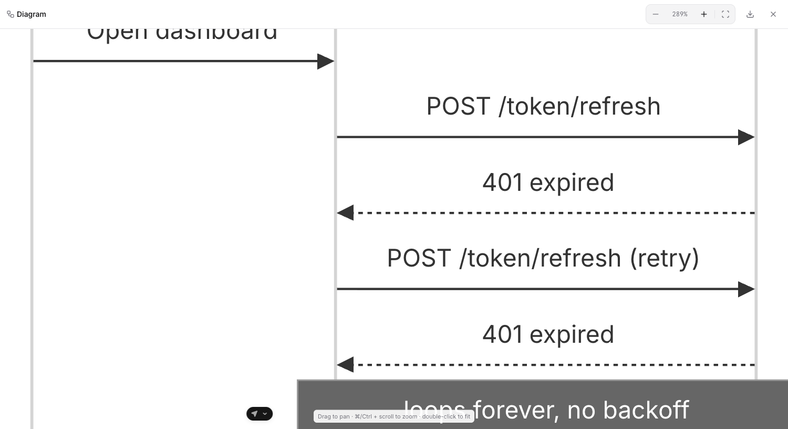
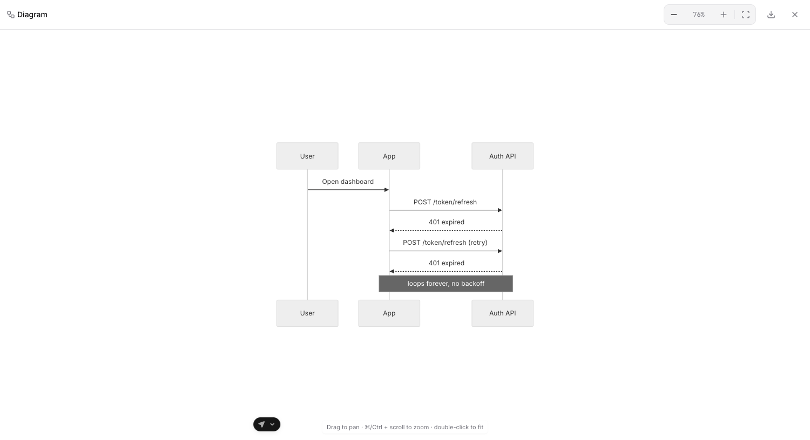
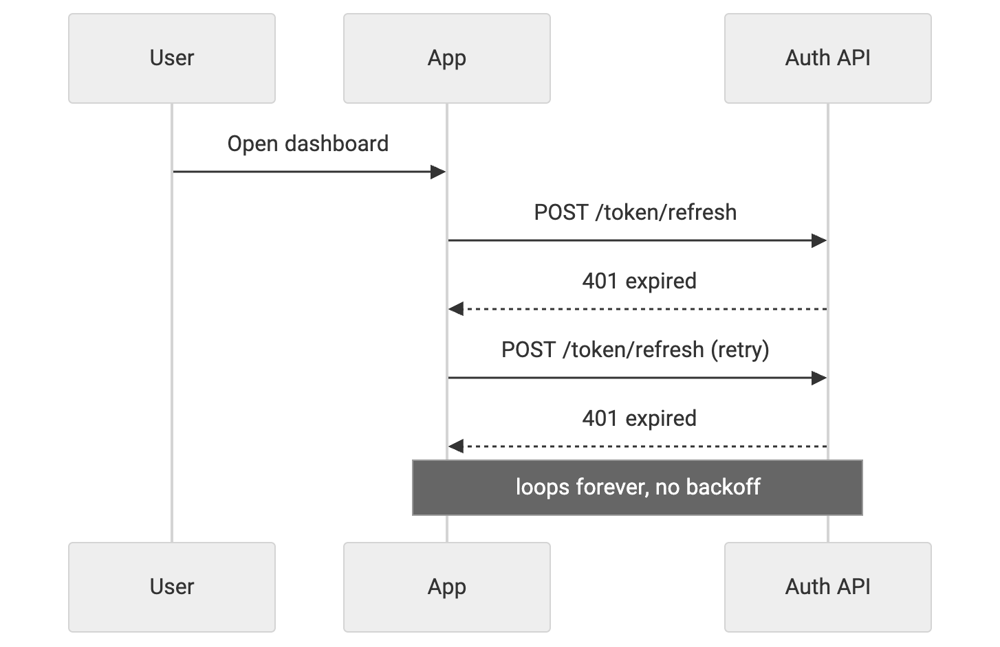
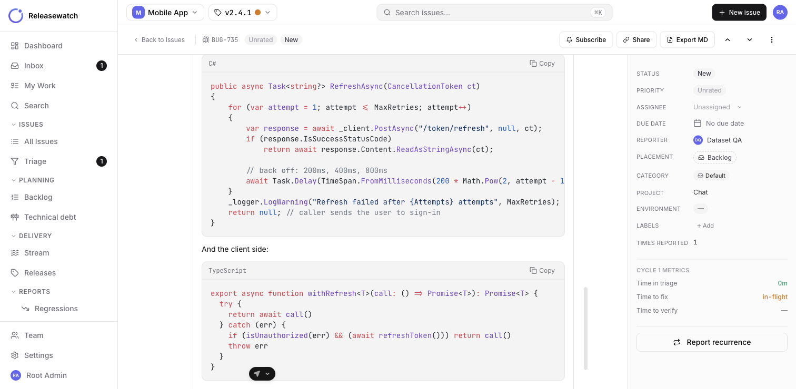
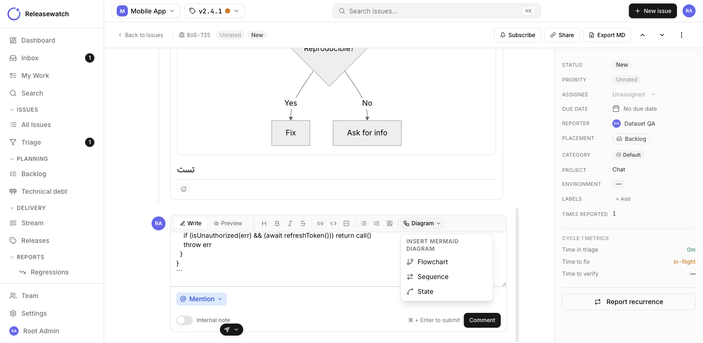
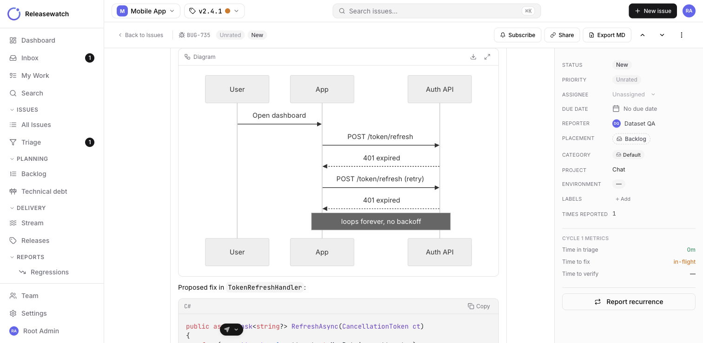
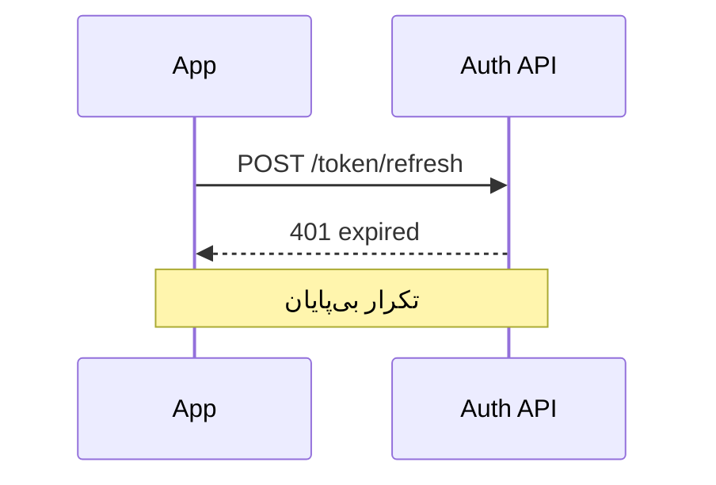

<div dir="rtl">

# یادداشت انتشار — نمودار، کد و ویرایشگر جدید نظرها

**تاریخ:** ۱۴ مهر ۱۴۰۵ (۶ اکتبر ۲۰۲۶)

از این نسخه می‌توانید در نظرها و توضیحات آیتم‌ها، کنار متن معمولی، **نمودار** بکشید و **کد** را با رنگ‌بندی خوانا بگذارید. ویرایشگر نظرها هم نوار ابزار کامل‌تری گرفته است.

---

## ✨ تازه‌ها

### ۱. نمودار Mermaid در نظرها و توضیحات

کافی است کد نمودار را داخل یک بلوک ` ```mermaid ` بنویسید تا به‌جای متن، خودِ نمودار نمایش داده شود. متن عادی، لیست، کد و چند نمودار را می‌توانید **همه با هم در یک نظر** داشته باشید.

نمودارها هر جایی که متن مارک‌داون نمایش داده می‌شود دیده می‌شوند: نظرها، توضیحات آیتم، صفحه‌ی تریاژ و پیش‌نمایش ویرایشگر.


- نمودار با پوسته‌ی روشن و تیره هماهنگ می‌شود.
- اگر کد نمودار ایراد داشته باشد، به‌جای کادر خالی، پیام خطا و متن نمودار نشان داده می‌شود تا راحت اصلاحش کنید.

### ۲. نمایش تمام‌صفحه با بزرگ‌نمایی

با دکمه‌ی **بزرگ‌کردن** (بالای هر نمودار) نمودار تمام‌صفحه باز می‌شود و از اول طوری تنظیم می‌شود که کامل در صفحه جا شود.



| کار | روش |
|---|---|
| بزرگ‌نمایی / کوچک‌نمایی | دکمه‌های **+** و **−**، یا کلیدهای `+` و `−` |
| بزرگ‌نمایی با ماوس | نگه‌داشتن ⌘ (یا Ctrl) و چرخاندن چرخ ماوس، یا نیشگون روی ترک‌پد |
| اندازه‌ی واقعی (۱۰۰٪) | کلیک روی درصد بزرگ‌نمایی |
| جا شدن در صفحه | دکمه‌ی **Fit**، کلید `0`، یا دوبار کلیک |
| جابه‌جا کردن نمودار | کشیدن با ماوس یا اسکرول معمولی |
| بستن | دکمه‌ی ✕ یا کلید Esc |

| بزرگ‌نمایی | کوچک‌نمایی |
|---|---|
|  |  |

اگر نمودار را از داخل پنجره‌ی «آیتم جدید» باز کنید، Esc فقط نمایش تمام‌صفحه را می‌بندد و پنجره و متن نوشته‌شده سر جایش می‌ماند.

### ۳. دانلود نمودار به‌صورت PNG

با دکمه‌ی **دانلود** (کنار دکمه‌ی بزرگ‌کردن، و در نوار بالای نمایش تمام‌صفحه) نمودار به‌صورت فایل `diagram.png` با کیفیت دو برابر ذخیره می‌شود؛ مناسب برای گزارش، ارائه یا پیام.



### ۴. رنگ‌بندی کد (Syntax highlighting)

بلوک‌های کد حالا مثل VS Code و GitHub رنگ‌بندی می‌شوند و بالای هر بلوک **نام زبان** و دکمه‌ی **کپی** هست.



- **زبان‌های پشتیبانی‌شده:** C#، Razor، JavaScript، TypeScript، JSX/TSX، Python، Java، Kotlin، Go، Rust، C/C++، Swift، PHP، Ruby، SQL، JSON، YAML، TOML، XML/HTML، CSS/SCSS، Bash، PowerShell، Dockerfile، HTTP و diff.
- نام‌های کوتاه هم کار می‌کنند؛ مثلاً `cs` یا `c#` برای C#، `ts` برای TypeScript و `sh` برای Bash.
- کد همیشه چپ‌به‌راست نمایش داده می‌شود، حتی داخل نظری که به فارسی نوشته شده.
- اگر زبان مشخص نشود یا ناشناخته باشد، کد بدون رنگ و خوانا نمایش داده می‌شود.

### ۵. نوار ابزار جدید ویرایشگر نظرها

ویرایشگر نظرها دو زبانه‌ی **نوشتن** و **پیش‌نمایش** دارد و نوار ابزارش دسته‌بندی شده است:

- **قالب متن:** تیتر، پررنگ، کج، خط‌خورده
- **پیوند و کد:** لینک، کد درون‌خطی، بلوک کد
- **لیست و نقل‌قول:** لیست نقطه‌ای، لیست شماره‌دار، نقل‌قول
- **منوی نمودار:** درج سریع یک نمودار آماده — **Flowchart**، **Sequence** یا **State** — تا فقط متنش را عوض کنید.



بهبودهای کوچک‌تر:

- لیست، نقل‌قول و تیتر روی **همه‌ی خطوط انتخاب‌شده** اعمال می‌شود، نه فقط خط اول.
- بلوک کد و نمودار همیشه در خط جداگانه درج می‌شوند و به پاراگراف قبلی نمی‌چسبند.



---

## ⌨️ میان‌برهای ویرایشگر

| میان‌بر | کار |
|---|---|
| ⌘B / Ctrl+B | پررنگ |
| ⌘I / Ctrl+I | کج |
| ⌘K / Ctrl+K | درج لینک (هنگام نوشتن، به‌جای باز کردن جست‌وجوی سریع) |
| ⌘Enter / Ctrl+Enter | ثبت نظر |

---

## 📝 نمونه

این متن را در یک نظر بنویسید و به زبانه‌ی **پیش‌نمایش** بروید:

````markdown
علت: تمدید توکن بعد از خطای `401` بی‌پایان تکرار می‌شود.



```csharp
await Task.Delay(TimeSpan.FromMilliseconds(200 * Math.Pow(2, attempt - 1)), ct);
```
````

</div>
